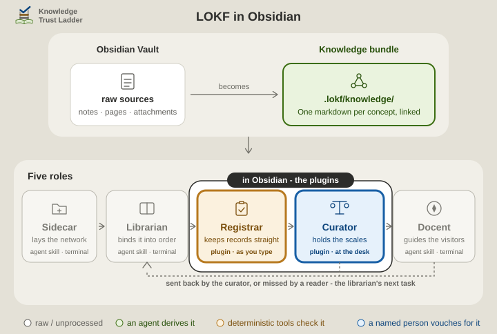

# Architecture

This page says what a knowledge bundle is, which role KTL Curator plays in keeping one, and how the bundle sits beside your own notes. It is for anyone deciding whether to use the plugin, and for anyone who keeps a bundle with it. [Install](install.md) gets it running, and [Using it](using.md) lists the panel, the review card and its five verbs, the in-editor aids, the commands and the settings.

<p align="center">
  <picture>
    <source media="(prefers-color-scheme: dark)" srcset="../.assets/ktl-obsidian-plugins-card-dimmed.svg">
    
  </picture>
</p>

A bundle is a folder of Markdown notes in the [Linked Open Knowledge Format](https://lokf.nolan-nichols.com/) (LOKF): one concept per note, a few properties on each, and an `index.md` at the root that names the bundle. The [`knowledge-trust-ladder`](https://github.com/noelmcloughlin/knowledge-trust-ladder) skills build one beside whatever they are run on, with every record marked a draft until a person has read it against its source.

That person is the **curator**, always a human, and often not the person who runs agents or terminals. This plugin is the curator's assistant: the `ktl-curator` skill's review session, done at a desk in Obsidian instead of in a terminal, with the same five verbs and the same fields written.

Its sibling [KTL Registrar](https://github.com/noelmcloughlin/obsidian-ktl-registrar) keeps each record well-formed meanwhile. Neither reaches a verdict of its own. All the roles are on the skills' [architecture page](https://github.com/noelmcloughlin/knowledge-trust-ladder/blob/main/docs/architecture.md#four-skills-three-lines-of-the-poem), and the two plugins under [the fifth role](https://github.com/noelmcloughlin/knowledge-trust-ladder/blob/main/docs/architecture.md#the-fifth-role-which-is-not-a-skill). For anyone who works under the **three lines of defence**, this plugin records the person's own first-line sign-off, and [docs/three-lines.md](https://github.com/noelmcloughlin/knowledge-trust-ladder/blob/main/docs/three-lines.md) says where the rest sit.

Obsidian is optional in both directions: the skills rely on `lokf validate`, not on this plugin, and the plugin works on any LOKF bundle however it was made. The format is all they share.

## Two vaults

Your everyday Obsidian vault is the **workshop**. The bundle is the **exhibition**: a second, smaller vault that you open through the `knowledge_bundle` link the skills leave at the root of the host. The two never index the same file, so nothing here touches your notes.

<p align="center">
  <picture>
    <source media="(prefers-color-scheme: dark)" srcset="../.assets/ktl-two-vaults-dimmed.svg">
    
  </picture>
</p>

How the `knowledge_bundle` doorway behaves on each host is recorded once in the skills' playbook [Open the knowledge bundle in Obsidian](https://github.com/noelmcloughlin/knowledge-trust-ladder/blob/main/.lokf/knowledge/playbooks/open-bundle-in-obsidian.md). If it is missing, `ln -s .lokf/knowledge knowledge_bundle` (or `mklink /J knowledge_bundle .lokf\knowledge` on Windows) makes it, or open `.lokf/knowledge` by path.

## Which folder is the bundle

With nothing configured, the vault decides:

1. A root `index.md` with a LOKF header means **the whole vault is the bundle**, which is the case whenever you open `knowledge_bundle` as a vault. That header is what gives each concept its id.
2. Otherwise a top-level `knowledge_bundle/` folder with its own `index.md` is the bundle, and notes outside it are left alone.
3. Otherwise there is **no bundle**. No report, no queue, nothing written, and the panel says why.

Inside a bundle, a note without trust fields is simply *nobody has checked this yet*; a note with no frontmatter at all is not a concept and is not counted.

Two settings widen that under *Settings → Scope*:

- **Bundle root folders**: for a bundle that sits as a folder inside a larger vault, or several of them (`bird-watching, projects/art-portfolio`). Each gets its own health line and queue; *N other concepts rely on this* is counted across all of them. Obsidian indexes such a folder like any other, so exhibits mix with your notes in search, graph and link suggestions, so the skills install the bundle as a separate vault instead (the playbook's [last section](https://github.com/noelmcloughlin/knowledge-trust-ladder/blob/main/.lokf/knowledge/playbooks/open-bundle-in-obsidian.md#why-the-bundle-is-never-a-real-folder-inside-a-vault) says why).
- **Treat the vault root as the bundle**: a break-glass switch for a vault that really is a bundle but whose root `index.md` has no header yet.

A folder inside a dot-folder is accepted but only read if something has put it in Obsidian's index (the community plugin *Hidden Folders Access* does that); otherwise the report says so rather than showing an empty bundle.

## Privacy

No network requests, no telemetry, no external services. The plugin reads the Markdown in the open vault and writes only through the five review verbs and the two file-creating commands (**Create curation policy**, **Record something missing**); every write is one you asked for by pressing a button. Settings, including the curator id, live in the vault's own plugin data.

## Development

See [CONTRIBUTING.md](../CONTRIBUTING.md). The layout follows the upstream [obsidian-sample-plugin](https://github.com/obsidianmd/obsidian-sample-plugin); `npm run lint` runs Obsidian's own `eslint-plugin-obsidianmd` ruleset.

```text
src/
  bundle.ts         bundle-root resolution, frontmatter split, relation targets
  trust.ts          one concept's trust record, the health counts, the ranked queue
  edits.ts          the exact write each verb makes, and the log.md upsert
  main.ts           plugin lifecycle: scanning, the review session, commands
  curator-view.ts   the "Curate" side panel: report + review card
  settings.ts       declarative settings tab (Obsidian 1.13+)
  ...               the in-editor tier badge, autocomplete and the field reference - one module each
scripts/
  smoke-test.ts     the three pure modules against a fixture bundle (npm run smoke-test)
  build-vocab.mjs   regenerates src/lokf-vocab.json from a pinned lokf.yaml (a maintenance step)
  fixtures/         a bundle with one concept per trust-label state, on purpose
docs/               the reasoning behind the labels
.lokf/              this repository's own LOKF knowledge bundle
```

`bundle.ts`, `trust.ts` and `edits.ts` import nothing: no Obsidian, no YAML parser, no `Date.now()`. They take already-parsed frontmatter and, where a date matters, the day as a parameter, so the whole rule set runs under plain Node via `npm run smoke-test` and every date-dependent label is reproducible. Parsing and the clock live in `src/main.ts`.

## This repository's own bundle

This repository keeps a bundle of its own under `.lokf/knowledge/`, maintained by the `knowledge-trust-ladder`, which a scheduled [workflow](../.github/workflows/knowledge-librarian.yaml) installs at run time. It is what the docent answers from, and none of it is part of the plugin. To contribute to it, [CONTRIBUTING.md](../CONTRIBUTING.md#development-setup) says which skills that takes.

## Read on

| | |
| --- | --- |
| How to get a bundle, where to install the plugin, and the quick start | [install.md](install.md) |
| The panel, the review card and its five verbs, the in-editor aids, the commands and the settings | [using.md](using.md) |
| How each label is computed and from which fields, what is left to KTL Registrar and the librarian, where the plugin sits on the four-tier trust model, what each host layout means for the review card, and the feedback file | [for-the-curious.md](for-the-curious.md) |
| The roles, the trust ladder and the two plugins, on the skills' own pages | [architecture](https://github.com/noelmcloughlin/knowledge-trust-ladder/blob/main/docs/architecture.md), [the bundle in Obsidian](https://github.com/noelmcloughlin/knowledge-trust-ladder/blob/main/docs/obsidian.md) |
| Contributing, the code of conduct and the AI covenant; reporting a security issue | [CONTRIBUTING.md](../CONTRIBUTING.md), [CODE_OF_CONDUCT.md](../CODE_OF_CONDUCT.md), [AI_COVENANT.md](../AI_COVENANT.md), [SECURITY.md](../SECURITY.md) |

## Credits

- [Nolan Nichols](https://lokf.nolan-nichols.com/), creator of [LOKF](https://lokf.nolan-nichols.com/specification/) and its [toolkit](https://github.com/nicholsn/lokf).
- The [LinkML Community](https://linkml.io/), creators of [LinkML](https://linkml.io/linkml/), the schema language LOKF is written in.
- [Introducing the Open Knowledge Bundle, Google blog](https://cloud.google.com/blog/products/data-analytics/how-the-open-knowledge-format-can-improve-data-sharing), creator of the Open Knowledge Format specification.
- [LLM Wiki, Karpathy](https://gist.github.com/karpathy/442a6bf555914893e9891c11519de94f), a pattern for building personal knowledge bases using LLMs.
- [obsidian-sample-plugin](https://github.com/obsidianmd/obsidian-sample-plugin), whose build, lint and release layout this repository follows.
- [knowledge-trust-ladder](https://github.com/noelmcloughlin/knowledge-trust-ladder), the `ktl-curator` skill this plugin implements as an in-editor workflow, and whose trust model and plain-language labels it shares.
- [KTL Registrar](https://github.com/noelmcloughlin/obsidian-ktl-registrar), the sibling plugin, this one's fork parent, and the source of the shared bundle-root plumbing in `src/bundle.ts`.

We know of no other tool that records a person's verdict in LOKF's trust fields. Validators for the plain OKF v0.2 layer beneath it, such as [OKF Enforcer](https://github.com/MartinForReal/okf-enforcer), check well-formedness only and are unrelated to curation.

## License

[Apache License 2.0](../LICENSE); see also [NOTICE](../NOTICE).
